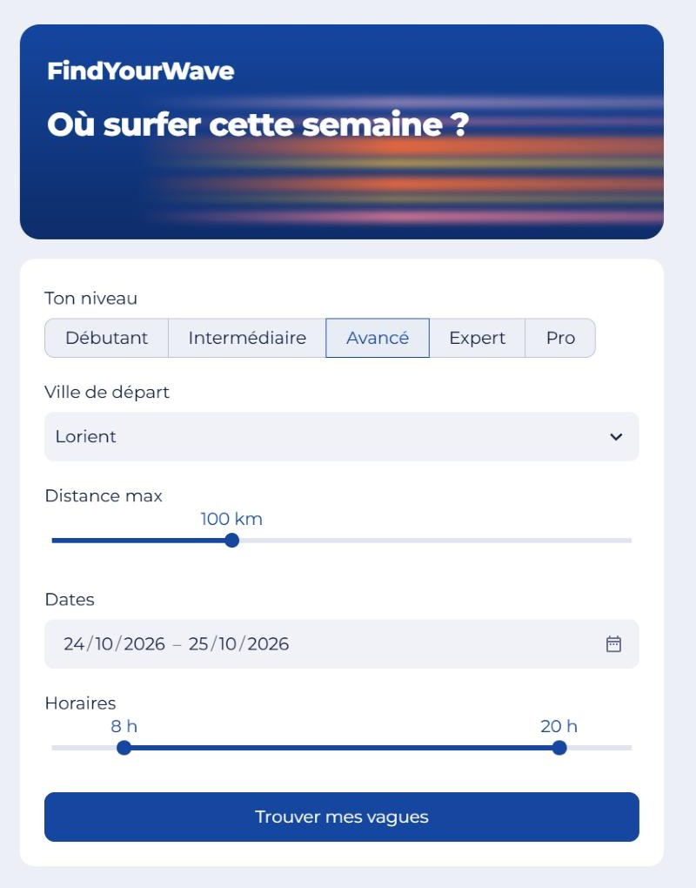
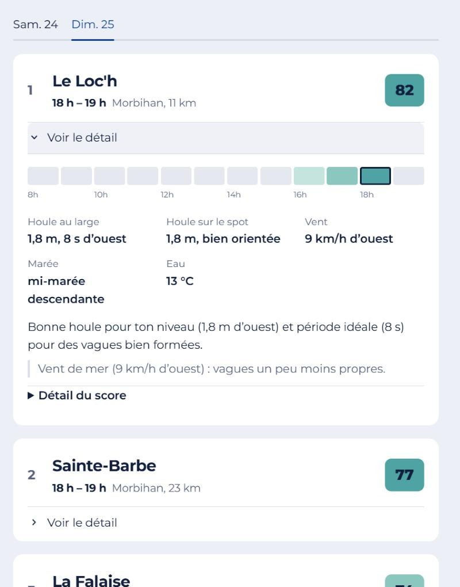
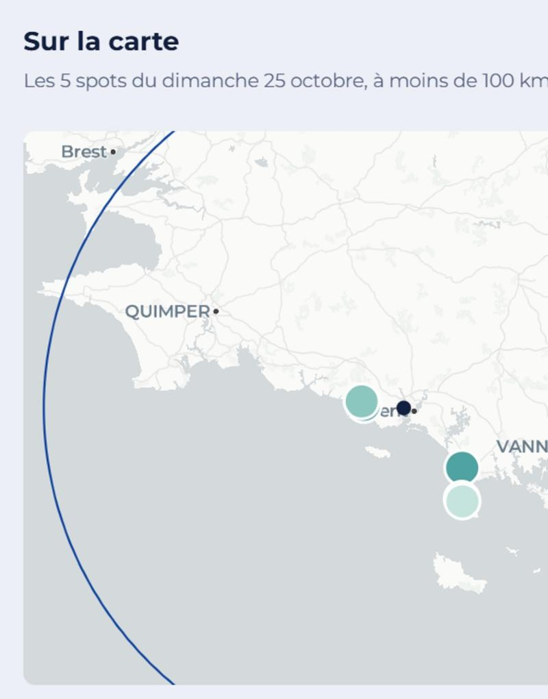

# FindYourWave

**Trouver le meilleur spot de surf en Bretagne, heure par heure, selon ton niveau.**

FindYourWave note 14 spots bretons pour chacun des 5 niveaux de surf (de débutant à pro), à partir des prévisions de houle, de vent et de marée. L'application propose, pour chaque jour choisi, les 5 meilleurs créneaux autour de ta ville de départ, et explique en français pourquoi chacun est recommandé et ce qui peut poser problème.

<p align="center">
  
  
  
</p>

## Liens utiles

| Quoi | Lien |
|---|---|
| Specs fonctionnelles et techniques (algorithme, données, interface, recette) | [Google Doc « FindYourWave - Algorithme de recommandation pour le surf »](https://docs.google.com/document/d/1T4jo2obXOgmlyBt6aLAR7TgoMA6Z_V0V8MXFOUA-Q4s/edit) |
| Maquettes de l'interface (planche C v2 retenue, palette, échelle des scores) | [Figma « FindYourWave – Maquettes interface »](https://www.figma.com/design/mRagf7nYUj9qZelxzkUze4) |
| Référentiels saisis à la main (spots, conditions idéales, seuils par niveau) | [Google Sheet « Matrice de passage »](https://docs.google.com/spreadsheets/d/1i_PB1GW9v_wIHYUn5sd08mzb2EUtB7GXq3hLMeN8o1I/edit) |
| Exécutions automatiques du pipeline (3 fois par jour) | [GitHub Actions](https://github.com/ameliechab/surf-recommendation/actions) |
| Source des prévisions | [Open-Meteo Marine](https://open-meteo.com/en/docs/marine-weather-api) et [Open-Meteo Weather](https://open-meteo.com/en/docs) |

## Contexte

Lors d'un surf trip au Portugal, débutante, j'ai suivi plusieurs fois des spots annoncés « débutants » qui ne l'étaient pas du tout ce jour-là, à cause de la taille des vagues ou du vent. Les applications de surf affichent les conditions d'un spot donné, mais aucune ne répond à la question qu'on se pose vraiment en voyage : **où aller, quel jour et à quelle heure, pour mon niveau ?**

FindYourWave répond à ce besoin, en priorité pour les surfeurs débutants ou intermédiaires qui ne connaissent pas encore les spots d'une région. C'est aussi un projet personnel pour développer mes compétences de product builder : partir d'un besoin réel et aller jusqu'à un produit en ligne, en passant par la data et le code.

J'ai porté le projet de bout en bout (cadrage du besoin, specs, modélisation des données, pipeline, algorithme, maquettes, interface, tests et recette) en travaillant avec l'IA, principalement Claude (Anthropic), comme binôme.

## Travailler avec l'IA

Ce projet est aussi une démonstration de ma façon de construire un produit avec l'IA :

- **Moi** : le besoin, les règles métier et les décisions. Je fixe les seuils par niveau dans le référentiel, je valide chaque règle de scoring et chaque choix d'interface, je relis les specs, je lance les tests et la recette, et je repère les incohérences dans les résultats (une houle de 2,1 m proposée à un intermédiaire, une houle « idéale » au bas de la fourchette d'un pro, un formulaire qui garde l'ancienne recherche…).
- **Claude** : propositions d'architecture et de règles, écriture du code et des tests, rédaction des specs dans le Google Doc, maquettes dans Figma, analyses sur les données d'audit et corrections à partir de mes retours.
- **La méthode** : avancer par petites étapes vérifiables, faire valider chaque décision avant de coder, tout documenter (specs, décisions, calibration) et tout tester (41 tests hors ligne, 20 contrôles SQL).

## Ce que j'ai fait

- **Cadrage produit et specs** : besoin, user stories, algorithme, modèle de données et recette, documentés dans le Google Doc ; décisions tracées et validées au fil du projet.
- **Modélisation et base de données** : 5 tables PostgreSQL (Supabase) avec contraintes d'intégrité (CHECK, clés étrangères), sécurité par ligne (RLS) et accès en lecture seule pour l'application.
- **Pipeline de données automatisé** : référentiels saisis dans Google Sheets, nettoyés et contrôlés « tout ou rien » ; prévisions Open-Meteo collectées et marée calculée à partir de la hauteur d'eau ; exécution 3 fois par jour avec GitHub Actions.
- **Algorithme de recommandation** : scoring pondéré par spot, heure et niveau (houle, période, vent, marée), règles d'éligibilité, pénalité de vent de mer, calibration rejouée sur 11 760 scores réels avant mise en production.
- **Qualité** : 20 contrôles SQL sur les données et 41 tests unitaires hors ligne (marée, scoring, sélection, explications).
- **Interface** : maquettes Figma (3 directions, palette, échelle de couleurs), puis application Streamlit responsive avec carte, explications en français générées par templates (sans IA) et export CSV.

## Chiffres clés

| | |
|---|---|
| Spots couverts | 14, en Finistère, Morbihan et Côtes-d'Armor |
| Niveaux | 5 (débutant, intermédiaire, avancé, expert, pro) |
| Scores recalculés | 11 760 (14 spots × 168 h × 5 niveaux), 3 fois par jour |
| Appels API par collecte | 2 (toutes les coordonnées dans une seule requête par API) |
| Contrôles qualité | 20 contrôles SQL, 41 tests unitaires |

## Architecture

```
Google Sheet (référentiels, saisis à la main)
        │  sync_sheets.py : nettoyage + contrôles, tout ou rien
        ▼
┌──────────────────────────────────────────────┐
│  Supabase (PostgreSQL), 5 tables             │
│  surf_spot_properties                        │
│  surf_spot_conditions_reference              │
│  surf_level_conditions_reference             │
│  marine_forecast      ◄── collect.py ◄── Open-Meteo Marine + Weather
│  spot_hour_scores     ◄── score.py           │
└──────────────────────────────────────────────┘
        ▲
GitHub Actions : sync, collecte puis scoring à 4 h, 11 h et 17 h UTC

Supabase (clé publishable, lecture seule)
        │  app.py : filtres, meilleur créneau, explications
        ▼
Interface Streamlit (ordinateur et téléphone)
```

| Brique | Rôle |
|---|---|
| Python 3.13 (pandas, requests, supabase-py) | Ingestion, calcul de la marée, scoring, sélection |
| Supabase (PostgreSQL) | Stockage, contraintes d'intégrité, API en lecture |
| Google Sheets | Saisie des référentiels par un humain |
| Open-Meteo Marine + Weather | Prévisions horaires gratuites, sans clé |
| GitHub Actions | Planification (cron), exécution, secrets chiffrés |
| Streamlit + pydeck | Interface web et carte des spots |
| Figma | Maquettes et choix visuels |

## Fonctionnement

**1. Pipeline de données.** Les référentiels (spots, fenêtres de houle et de vent idéales, seuils par niveau) sont saisis dans Google Sheets puis chargés en base après contrôle : décimales françaises, nombres transformés en dates par Sheets, bornes, cohérence entre onglets. Les prévisions horaires viennent d'Open-Meteo. Le stade et le sens de la marée sont calculés à partir de la hauteur d'eau. → [docs/pipeline.md](docs/pipeline.md)

**2. Scoring.** Pour chaque spot, chaque heure des 7 prochains jours et chaque niveau : éligibilité (niveau du spot, nuit, houle trop faible ou trop forte, vent trop fort), puis 4 sous-scores de 0 à 100 et un score global pondéré (houle 40 %, période 20 %, vent 25 %, marée 15 %), réduit quand le vent souffle de la mer. Une houle mal orientée est jugée sur sa hauteur utile sur le spot. → [docs/scoring.md](docs/scoring.md)

**3. Interface.** L'utilisateur choisit son niveau, sa ville de départ, une distance, des dates et des horaires. Pour chaque jour, l'app garde le meilleur créneau de chaque spot, affiche les 5 meilleurs et explique le résultat : points forts, remarques, points de vigilance et détail du score. → [docs/interface.md](docs/interface.md)

## Contenu du dépôt

| Fichier | Rôle |
|---|---|
| `sync_sheets.py` | Google Sheet → 3 tables de référence |
| `collect.py`, `tide.py` | Open-Meteo → `marine_forecast`, calcul de la marée |
| `score.py` | Éligibilité, sous-scores et score global → `spot_hour_scores` |
| `app.py` | Interface Streamlit |
| `selection.py`, `explain.py`, `ui.py` | Sélection des créneaux, explications, habillage (Python pur, testés sans Streamlit) |
| `config.py`, `db.py` | Paramètres et connexion Supabase |
| `sql/` | Schéma, droits, migrations et requêtes de contrôle qualité |
| `tests/` | 41 tests unitaires hors ligne (`python -m pytest tests`) |
| `docs/` | Détail du pipeline, du scoring et de l'interface |
| `.github/workflows/` | Collecte et scoring 3 fois par jour, synchronisation manuelle du Sheet |
| `.streamlit/` | Thème de l'app et modèle de fichier de secrets |

## Suite (V2)

- Coefficient de marée (source SHOM) et fréquentation des spots (`crowd_level`) dans le scoring.
- Ville de départ libre (géocodage) à la place de la liste de 18 villes.
- Ouverture à d'autres régions de surf.

<details>
<summary><b>Installer et lancer le projet en local</b></summary>

Prérequis : Python 3.13, un projet Supabase et un Google Sheet partagé en lecture par lien.

```bash
python -m venv .venv
# Windows (Git Bash) ; sous macOS/Linux : source .venv/bin/activate
source .venv/Scripts/activate
pip install -r requirements.txt
# puis renseigner l'URL et la clé secrète Supabase, et les gid des onglets
cp .env.example .env
```

1. Dans Supabase, **SQL Editor** : exécuter `sql/001_schema.sql`.
2. Charger les référentiels : `python sync_sheets.py --dry-run` (vérifie seulement), puis `python sync_sheets.py`.
3. Collecter : `python collect.py --spot la_torche --dry-run` (un spot, aperçu dans `forecast_preview.csv`), puis `python collect.py`.
4. Scorer : `python score.py --dry-run` (aperçu dans `scores_preview.csv`), puis `python score.py`.
5. Contrôler : exécuter `sql/003_checks.sql` à `006_scores_check.sql`.
6. Interface : copier `.streamlit/secrets.toml.example` en `.streamlit/secrets.toml` (URL et clé **publishable**), puis `streamlit run app.py`. L'app s'ouvre sur `http://localhost:8501`.
7. Tests : `python -m pytest tests`.

**Automatisation.** Dans GitHub, **Settings → Secrets and variables → Actions** :
- *Secrets* : `SUPABASE_URL`, `SUPABASE_SECRET_KEY` ;
- *Variables* : `GID_SPOT_PROPERTIES`, `GID_SPOT_CONDITIONS`, `GID_LEVEL_CONDITIONS`.

Le workflow `collect` synchronise alors le Sheet, collecte les prévisions puis calcule les scores à 4 h, 11 h et 17 h UTC. Il peut aussi se lancer à la main depuis l'onglet **Actions**.

**Mise en ligne de l'interface.** Sur [Streamlit Community Cloud](https://share.streamlit.io) : *Create app*, dépôt `ameliechab/surf-recommendation`, branche `main`, fichier `app.py`, Python 3.13. Dans *Advanced settings → Secrets*, coller `SUPABASE_URL` et `SUPABASE_PUBLISHABLE_KEY`. Chaque `git push` sur `main` redéploie l'app.

</details>

## Auteure

**Amélie Chabrand**, product builder. [LinkedIn](https://www.linkedin.com/in/am%C3%A9lie-chabrand-145505196/)
